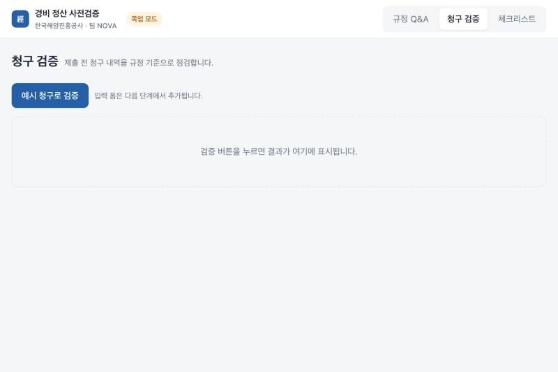
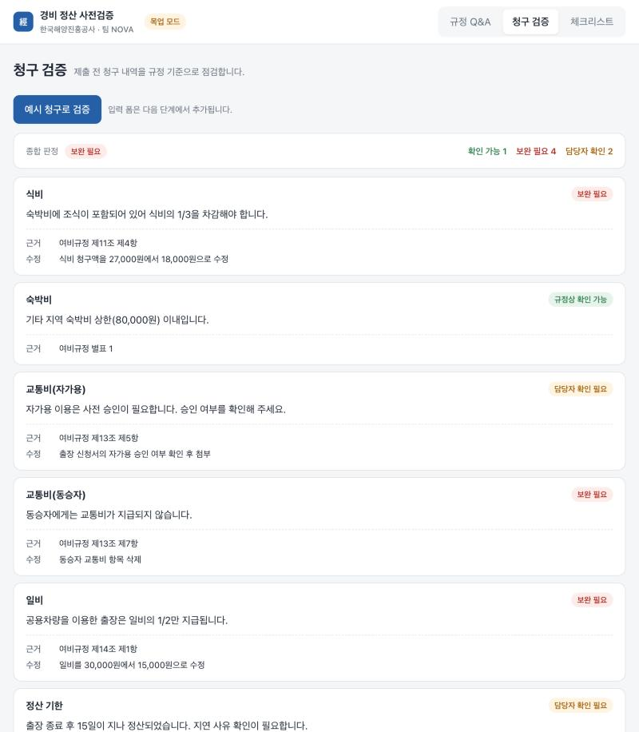
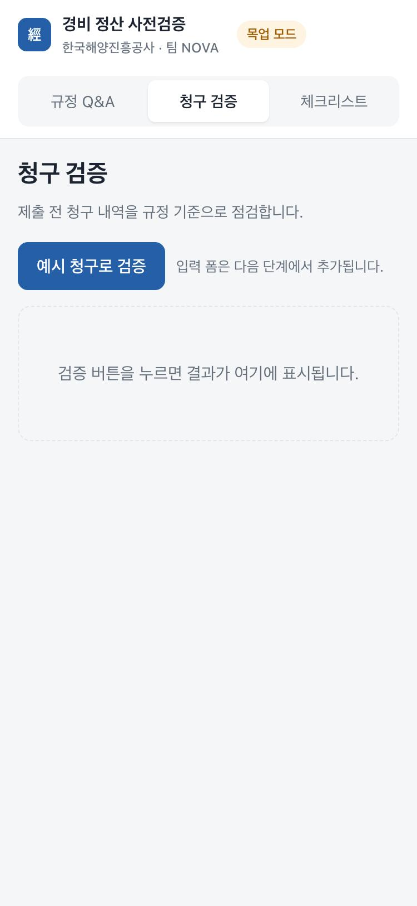
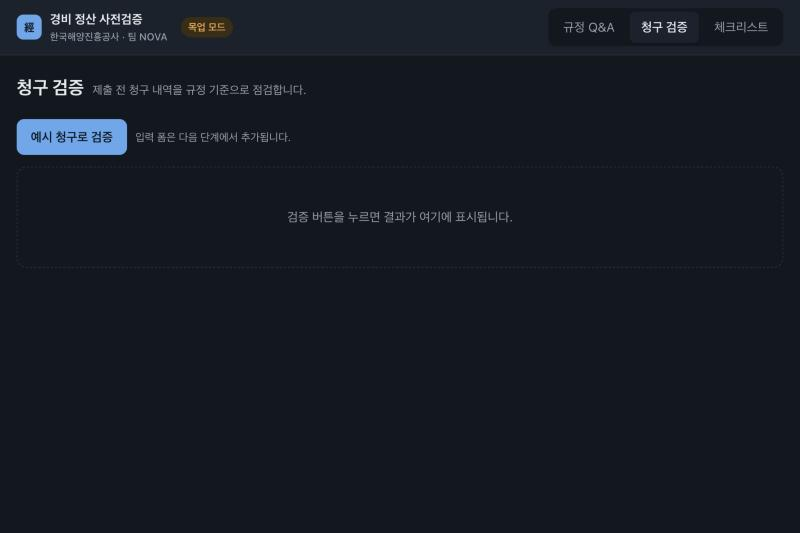

# 프론트엔드 베이스코드 진행 보고

> 작성: 프론트엔드/UI 담당 · 2026-10-30
> 대상: 팀 NOVA 전원
> 저장소: https://github.com/spencerpark00/-Frontend

---

## 1. 한 줄 요약

10/28 회의에서 정한 "프론트 베이스코드"가 완성되었습니다.
**화면 3개의 틀, 백엔드와 통신하는 모듈, 백엔드 없이 돌아가는 목업 모드, 검증 결과 카드, 실행 안내**까지 갖춰져 있고, 지금부터는 이 위에 기능을 얹는 단계입니다.

| 베이스코드 완성 기준 | 상태 |
|---|---|
| ① 규정 Q&A · 청구 검증 · 체크리스트 세 화면을 오가는 레이아웃 | 완료 |
| ② API 호출 모듈 (백엔드 주소·에러 처리를 한 곳에서 관리) | 완료 |
| ③ 목업 모드 (백엔드 없이 가짜 응답으로 동작) | 완료 |
| ④ 검증 결과 카드 (판정 3단계 색 + 근거 조항 + 수정 방법) | 완료 |
| ⑤ README 실행 방법 | 완료 |
| 실제 백엔드 연결 테스트 | 백엔드 준비 후 |

---

## 2. 화면 소개

### 2-1. 청구 검증 화면 (현재 유일하게 동작하는 화면)



- 상단 헤더는 모든 화면 공통입니다. 왼쪽에 로고와 팀명, 오른쪽에 탭 3개.
- 헤더의 노란 **목업 모드** 뱃지는 "지금 가짜 데이터로 동작 중"이라는 뜻입니다. 백엔드에 연결하면 초록 **백엔드 연결**로 바뀝니다.
- **예시 청구로 검증** 버튼을 누르면 잠깐 "검증 중…"이 표시된 뒤 결과가 나옵니다.



- 맨 위 요약 줄: 왼쪽에 **종합 판정**, 오른쪽에 판정별 건수.
- 아래 카드 한 장 = 청구 항목 하나. 카드 안에는
  - 항목명 (식비, 숙박비, …)
  - 판정 뱃지 (오른쪽 위)
  - 한 줄 메시지 (무엇이 문제인지)
  - **근거**: 규정 조항
  - **수정**: 어떻게 고치면 되는지
- 판정 3단계는 색으로 구분합니다.

| 판정 | 색 | 의미 |
|---|---|---|
| 규정상 확인 가능 | 초록 | 문제 없음 |
| 보완 필요 | 빨강 | 규정에 어긋나므로 고쳐야 함 |
| 담당자 확인 필요 | 노랑 | 규정만으로 판단 불가, 사람이 봐야 함 |

> 지금 나오는 결과 7건은 전부 **가짜 데이터**입니다. 규정 정리본에서 뽑은 사례(조식 포함 숙박, 자가용 사전 승인, 동승자 교통비, 공용차량 일비, 15일 정산 기한, 심야 법인카드 사용 등)를 넣어둔 것이고, 실제 판정은 백엔드가 붙어야 나옵니다.

### 2-2. 규정 Q&A · 체크리스트 화면 (자리만 잡아둠)


- 제목과 설명만 있고 내용은 "준비 중"입니다. 기능 단계에서 채웁니다.

### 2-3. 모바일 · 다크 모드





- 폰 폭에서는 탭이 두 번째 줄로 내려가 가로로 펼쳐지고, 카드는 세로로 쌓입니다.
- 시스템이 다크 모드면 같은 구조로 어둡게 바뀝니다. 별도 작업 없이 색 변수만으로 처리됩니다.

---

## 3. 코드 구조 (쉽게)

```
expense-agent/
├── README.md               실행 방법
├── docs/API.md             프론트·백엔드 연동 약속
├── frontend/               ← 이번에 만든 것
│   ├── .env                백엔드 주소, 목업 스위치
│   └── src/
│       ├── App.jsx                 메뉴 목록 + 현재 화면
│       ├── index.css               색·폰트 변수와 공통 스타일
│       ├── api/
│       │   ├── client.js           백엔드 호출 함수 3개
│       │   └── mock.js             목업 모드 응답
│       ├── mocks/                  가짜 응답 JSON 3개
│       ├── components/
│       │   ├── Layout.jsx          헤더 + 탭 메뉴
│       │   ├── VerdictBadge.jsx    판정 뱃지
│       │   ├── ResultCard.jsx      결과 카드 한 장
│       │   └── VerifyResult.jsx    요약 + 카드 목록
│       └── pages/
│           ├── QaPage.jsx          규정 Q&A 화면
│           ├── VerifyPage.jsx      청구 검증 화면
│           └── ChecklistPage.jsx   체크리스트 화면
└── backend/                ← 백엔드 담당이 추가 예정
```

**각 부분이 하는 일을 한 줄씩**

- `App.jsx` 탭 3개 목록이 적혀 있습니다. 화면을 추가하려면 여기 한 줄 추가 + `pages/`에 파일 하나.
- `api/client.js` 화면은 이 파일의 함수 3개(`askQa`, `verifyClaim`, `getChecklist`)만 부릅니다. 백엔드 주소, 에러 처리는 여기서만 다룹니다.
- `api/mock.js` + `mocks/` 백엔드 대신 응답하는 가짜 서버. 백엔드가 늦어도 프론트 작업이 멈추지 않습니다.
- `components/` 여러 화면이 같이 쓰는 부품. 결과 카드는 어느 화면에서든 같은 모양으로 나옵니다.
- `index.css` 맨 위에 색 변수가 모여 있습니다. 판정 색이나 포인트 색을 바꾸려면 여기만 고칩니다.

**버튼을 눌렀을 때 일어나는 일**

```
[예시 청구로 검증] 클릭
   → VerifyPage 가 client.verifyClaim(청구) 호출
       → 목업 모드면 mocks/verify.json 을 돌려줌
       → 실제 모드면 POST http://localhost:8000/api/verify 로 요청
   → 돌아온 JSON 을 VerifyResult 에 넣으면 카드가 그려짐
```

---

## 4. 백엔드와의 약속

자세한 내용은 [docs/API.md](API.md) 에 있습니다. 핵심만 적으면:

| 기능 | 방식 | 주소 | 돌려주는 것 |
|---|---|---|---|
| 규정 Q&A | POST | `/api/qa` | 답변 + 근거 조항 목록 |
| 청구 검증 | POST | `/api/verify` | 종합 판정 + 항목별 (판정·메시지·근거·수정) |
| 체크리스트 | GET | `/api/checklist?type=국내출장` | 체크 항목 목록 |

- 판정 값은 `규정상 확인 가능` / `보완 필요` / `담당자 확인 필요` 세 가지 문자열로 고정.
- 에러는 `{ "error": "설명" }` 형태.
- `frontend/src/mocks/*.json` 이 응답 모양의 실물 예시입니다. 백엔드는 이 모양대로 돌려주면 프론트를 손대지 않아도 됩니다.

---

## 5. 진행 현황

**완료 (커밋 4개)**

| 커밋 | 내용 |
|---|---|
| chore | Vite + React 프로젝트 생성, 깃 저장소 |
| feat | 레이아웃과 빈 화면 3개, 디자인 토큰 |
| feat | API 호출 모듈, 목업 모드, 헤더 모드 뱃지 |
| feat | 검증 결과 카드, README, API 문서 |

**다음 (기능 단계)**

| 순서 | 화면 | 할 일 |
|---|---|---|
| 1 | 청구 검증 | 출장 종류·직급·항목별 금액을 입력하는 폼 (결과 카드는 이미 있음) |
| 2 | 규정 Q&A | 채팅 UI, 답변 아래 근거 조항 표시 |
| 3 | 체크리스트 | 항목 목록 불러오기, 체크 표시, 근거 조항 보기 |
| 4 | 공통 | 백엔드 연결 테스트 (백엔드 준비 후) |

**범위 결정이 필요한 것** (10/26 회의에서 미정)

- 관리자용 화면 포함 여부
- 2차 기능 (영수증 인식, 출장비 자동 계산) 포함 여부

---

## 6. 팀에 확인받고 싶은 것

실제 화면이 있으니 아래를 보고 의견을 주시면 기능 단계에 반영하겠습니다.

1. **결과 카드 배치.** 담당자가 가장 먼저 봐야 할 게 판정인지 수정 방법인지. 지금은 판정이 오른쪽 위, 수정 방법이 맨 아래입니다.
2. **판정 색.** 초록·빨강·노랑이 직관적인지. 특히 "담당자 확인 필요"를 노랑으로 둔 것.
3. **문제 있는 항목만 보기.** 청구 하나에 항목이 많을 때 "보완 필요만 보기" 필터가 필요한지.
4. **탭 순서와 흐름.** 직원이 체크리스트를 먼저 보고 검증하는 흐름이면 탭 순서나 연결 방식을 바꿀 수 있습니다.

---

## 7. 직접 실행해보기

```bash
git clone https://github.com/spencerpark00/-Frontend.git
cd -Frontend/frontend
npm install
npm run dev
```

브라우저에서 http://localhost:5173 을 열면 됩니다. Node.js 18 이상이 필요합니다.
백엔드 없이 목업 모드로 바로 동작하니, 청구 검증 탭에서 버튼을 눌러보세요.
